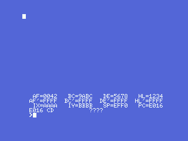
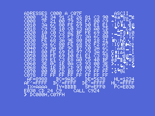
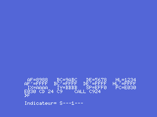
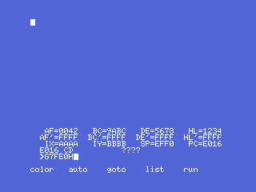
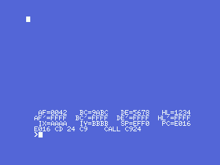
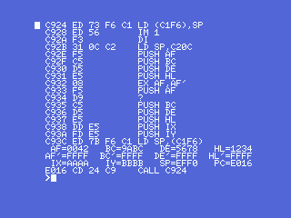

# The debugger, brought back to life

Demonia carries a whole machine-code monitor inside it — a **debugger**, written
by Claude Sablatou for Loriciels in 1984, riding along in the 1986 game because
the same man wrote both. The [Findings](FINDINGS.html) page tells how it was
found and why, on this tape, **it no longer answers**: the game recorded its 24
screen records straight over the monitor's own data section (`0xD000`-`0xD8FF`),
erasing its command table, its disassembler tables and about a dozen of its
screen and keyboard subroutines.

This page is about putting it back on its feet — and it works.

> **To be clear from the start: this is not the original debugger recovered
> whole. We do not have 100% of Sablatou's code.** About 40% of the monitor — the
> data and routines the game erased — no longer exists anywhere and had to be
> rebuilt. What runs is roughly 60% his surviving original code and 40%
> reconstructed to match it: a working equivalent, not the lost original.

## What survived, and what did not

Sixty per cent of the monitor is intact: its command interpreter, its
single-step, its register dump, its disassembler **code**, and all its text, live
on untouched from `0xC24D` to `0xCFFF` and `0xD900` to `0xDAC7`. What the game
destroyed was its **data**, in `0xD000`-`0xD8FF`:

| lost piece | what it was |
|---|---|
| command table (`0xD5C6`) | 15 entries of *initial letter + handler pointer* |
| disassembler tables (`0xD64A`, `0xD67C`, `0xD826`, `0xD88B`, `0xD5F3`…) | ~2 KB: mnemonics, opcode maps, operand-format pointers |
| screen/keyboard subroutines (`0xD200`-`0xD2E8`) | clear, new-line, wait-a-key… |

**This is a reconstruction, not a recovery.** Sablatou's original bytes for
those tables and routines are gone for good. What follows is a *functional
equivalent*: new code and data that fulfil the exact same contracts the
surviving code expects, so that his surviving code runs again and the monitor
behaves as it did.

## Bringing back the interactive monitor

The dead zone took a dozen of the monitor's own screen and keyboard subroutines
with it (`0xD200`-`0xD2E8`). Each is rebuilt at its exact address from the
contract its surviving callers demand: `0x0072`/INITXT for the 40-column text
screen (proven by its own cell geometry, `row*40 + col + 2`), a non-blocking key
read over CHSNS/CHGET, the pair that swap the slot layout between the monitor's
memory and the stopped program's, the beep on a bad command, and the BASIC error
hook. With those in place the monitor **boots, sets up its screen, and paints the
twelve registers of the stopped program** — the picture at the top of this page,
where `HL=1234`, `DE=5678`, `IX=AAAA` are the values a small launcher put there on
purpose.

The command table is rebuilt entry by entry, each surviving handler given back
its letter, and every command answers — typed for real into the monitor and read
back off the screen on a Philips VG-8020:

| key | command | what it does |
|---|---|---|
| `L` | list | disassembles a range of memory |
| `D` | dump | shows memory as hex and ASCII, and edits it under a cursor |
| `S` | search | hunts for a byte from an address and lands on it |
| `R` | registers | prints the twelve of the stopped program |
| `F` | flags | spells out `SZ1H1PNC` for it |
| `I` | interrupts | allowed or forbidden on the way back |
| `B` | breakpoints | lists the ten slots |
| `T` | trace | single-steps the stopped program |
| `=` | evaluate | reads a number in any base and prints it |
| `G` | go | restores the registers and jumps |

`D` is the debugger's workbench: a screen of memory in hex and ASCII, a cursor you
drive with the arrows, and hex digits that overwrite the byte under it —

`F` reads the flag byte straight off the stopped program — here `S---1---`, the
sign flag and the ever-set bit of an `AF` whose low byte is `0x88`:

**`G` — Go**, and the fossil. The handler at `0xC5D3` parses a hex address,
stores it and jumps there. The [fossil](FINDINGS.html) left the last thing the
author ever typed, `G7FE0`, frozen in the input buffer. Typing that exact command
back into the resurrected monitor jumps to the sound routine at `0x7FE0` — his
1986 debugging session, replayed by hand:

**`T` — trace** is the single-step. It disassembles the next instruction, copies
it into a scratch buffer, runs it with the program's own registers, and takes
control back to redraw them advanced by one. It is the command that needs the
disassembler to tag each instruction by kind — a jump, a call, a return — so the
step knows how to resume, and it does: tracing a short loop marches the program
counter and the registers forward one instruction at a time.

One thing the monitor can no longer do in full: the `=` calculator reads and
converts a value in any base, but its **operator table lived at `0xD8FB`, inside
the dead zone**, so chained arithmetic (`+`, `-`, `*`, `/`) went with it — one
more small casualty of the overwrite, stated plainly.

## The disassembler

The disassembler was the hard part. Its tables were the most thoroughly erased,
and the routines that formatted its operands lived in the dead zone too. So the
disassembler is the most complete *equivalent*: a compact Z80 disassembler that
fulfils the monitor's contract — given an address in `IX`, it writes the mnemonic
text and the instruction length exactly where the surviving display code
(`0xC568`) expects them. Only that one call had to be repointed.

It covers the **whole Z80 instruction set** — unprefixed, `CB`, `ED`, `DD`/`FD`
(IX/IY) and `DDCB`/`FDCB` — and it was checked instruction by instruction in the
emulator, group by group: relative-jump targets, `(IX+d)` and `(IY-d)`
displacements, the `DD CB` bit operations and every instruction length. The
register dump already proves it on screen — the line under the registers reads the
instruction at the program counter:

And with the `L` (list) command wired to its surviving handler at `0xC535`, the
monitor will disassemble any range. The finest proof there is: **the monitor
disassembling its own machine code**, its entry routine, live on screen —
`LD (C1F6),SP`, `IM 1`, the register-saving `PUSH` sequence, `LD SP,(C1F6)`:

## How to read it, and how it was built

Numbers use the Intel/Loriciels convention the parser expects: a hex address
carries a trailing `H` (`L7FE0H,7FE6H`). The reconstruction lives in the
repository under `debugger/`: the disassembler generator (`gen_disasm.py`), the
rebuilt helpers and command table, and the openMSX scripts that boot the monitor
and captured every screenshot on this page on a real MSX1 (a Philips VG-8020).
Nothing here is a mock-up; every picture is a raw frame from the emulator running
the reconstructed monitor.

*Careful with the claim: what is measured is that the reconstructed monitor boots,
accepts every command and disassembles correctly, shown by the captures and an
instruction-by-instruction check of the disassembler. What is a reconstruction —
stated plainly — is the command table's letters, the rebuilt helper routines and
the disassembler itself; those are equivalents, not Sablatou's lost originals, and
one lost table (the `=` operators) is gone for good.*
